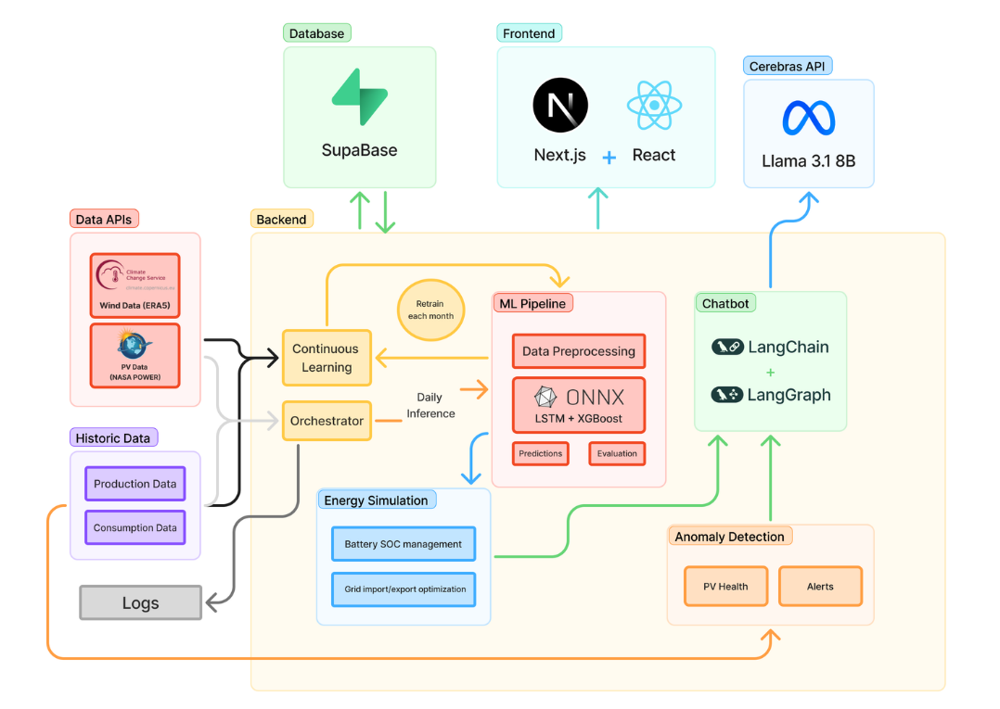
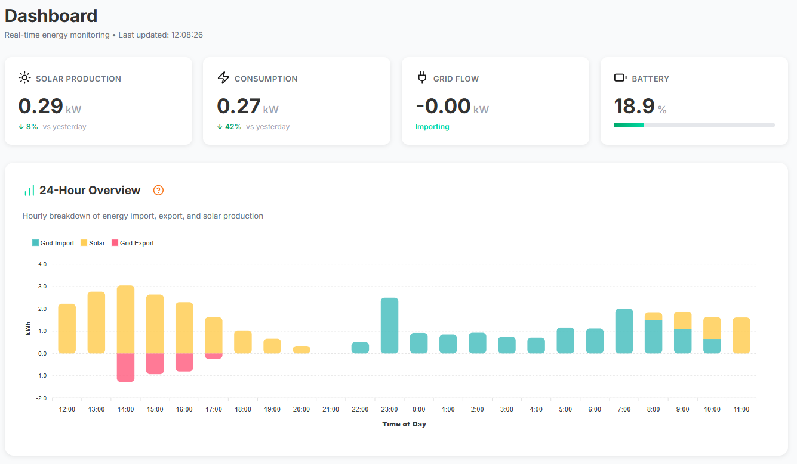
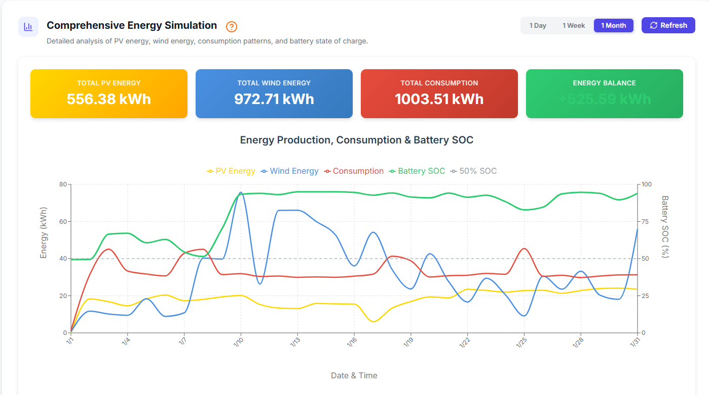

# Solaira

Solar energy management platform: a **Next.js frontend** for monitoring and
configuring a home PV + battery installation, and a **Python FastAPI backend**
for forecasting, simulation and predictive maintenance.

Two Python services run side by side:

| Service | Port | Entry point | Responsibility |
| --- | --- | --- | --- |
| Main API | `8001` | `backend/main.py` | Forecasting, energy simulation, PV monitoring, chatbot |
| Solar forecast | `8002` | `backend/models/quartz-solar-forecast` | 48-hour PV generation forecast (vendor: Quartz) |

The database and authentication are **Supabase** (Postgres + Auth), used directly
by the browser. The Python services never touch the database.



## Screenshots

| Dashboard — live monitoring | Energy simulation — 1-month analysis |
| --- | --- |
|  |  |

---

## Quick start

```bash
# 1. Configure the environment
cp .env.example .env.local        # Windows: copy .env.example .env.local
# then fill in Supabase URL, publishable key and secret key

# 2. Install frontend dependencies
npm ci

# 3. Create the database schema (once; needs SUPABASE_DB_URL in .env.local)
#    Dashboard > Settings > Database > Connection string > URI
npm run db:apply                  # idempotent; also backfills profile rows

# 4. Frontend (http://localhost:3000)
npm run dev

# 5. Backend (http://localhost:8001 and :8002)
# Python 3.11 exactly: pv-site-prediction (forecast service) requires <3.12.
# No activation needed — call the venv interpreter directly (works the same in
# Git Bash, PowerShell and cmd, and survives paths that contain spaces).
py -3.11 -m venv backend/.venv
backend/.venv/Scripts/python.exe -m pip install -r backend/requirements.txt

# The forecast service pins older packages, so it gets its own venv.
py -3.11 -m venv backend/.venv-forecast
backend/.venv-forecast/Scripts/python.exe -m pip install -r backend/models/quartz-solar-forecast/requirements.txt

backend/.venv/Scripts/python.exe backend/start.py
```

No Python 3.11 installed? `uv python install 3.11`, then build both venvs with uv:

```bash
uv venv --python 3.11 --seed backend/.venv
uv venv --python 3.11 --seed backend/.venv-forecast
uv pip install --python backend/.venv/Scripts/python.exe -r backend/requirements.txt
uv pip install --python backend/.venv-forecast/Scripts/python.exe -r backend/models/quartz-solar-forecast/requirements.txt
```

`--seed` adds `pip`; plain `uv venv` venvs have no pip, so the `python.exe -m pip`
lines above would fail there.

Do **not** rely on `activate` in this repository. From a shell already inside
`backend/`, the command is `.venv/Scripts/activate` (with `source` in Git Bash),
not `backend/.venv/Scripts/activate`. And under Git Bash a checkout path with
spaces (`My Files`, `TSYP 2025`) corrupts `PATH` during activation, so `python`
then disappears. The commands above call the interpreter by path and avoid the
problem entirely.

Requirements: **Node 22+** (see `.nvmrc`), **Python 3.11** specifically.

---

## Repository map

```
pages/            Next.js routes (Pages Router) — app + marketing
components/       Reusable React components + CSS modules
lib/
  config/         Env access, constants, solar-system catalogue
  api/            HTTP clients for the Python services
  auth/           API-route auth middleware
  hooks/          React hooks (data layer)
  utils/          Pure helpers (CSV parsing, CO2 math)
backend/
  main.py         FastAPI app — the endpoints the frontend consumes
  core/           phase_1 (training) · phase_2 (simulation) · phase_3 (monitoring)
  chatbot/        Support agent (langchain + Cerebras)
  models/         Trained artifacts + vendored Quartz forecast service
  tests/          pytest suite
tests/            Jest suite (unit, hooks, components, api)
database/         Supabase schema (+ legacy SQLite dump in legacy/)
docs/             Detailed documentation (see below)
```

---

## Documentation

| Document | What it covers |
| --- | --- |
| [docs/architecture.md](docs/architecture.md) | How the pieces fit; the full request/data flow |
| [docs/frontend.md](docs/frontend.md) | Pages, providers, hooks, components, styling |
| [docs/backend.md](docs/backend.md) | Services, modules, data sources, known gaps |
| [docs/api.md](docs/api.md) | Endpoint contracts with examples |
| [docs/environment.md](docs/environment.md) | Every env variable and its default |
| [docs/authentication.md](docs/authentication.md) | Supabase auth, RLS, guest mode |
| [docs/testing.md](docs/testing.md) | How to run both test suites |

Contributing: [CONTRIBUTING.md](CONTRIBUTING.md).

---

## Endpoints the frontend actually uses

```
POST :8001/energy-simulation    24h PV+wind+battery simulation
POST :8001/maintenance          performance-ratio / fault analysis
POST :8001/api/chat             chatbot
POST :8001/api/pv-systems/configure      configure monitored systems
POST :8001/api/pv-systems/monitoring     start / stop monitoring
GET  :8001/api/pv-systems/status         current status (polled)
GET  :8001/api/pv-systems/{id}/history   historical series
POST :8002/forecast/            via the Next.js proxy /api/solar-forecast
GET  /api/csv/{file}            CSV fixtures served by the Next.js route
```

Anything else in `backend/` is offline training tooling or unused, and is
documented as such in [docs/backend.md](docs/backend.md).

---

## License

MIT — see [LICENSE](LICENSE).
